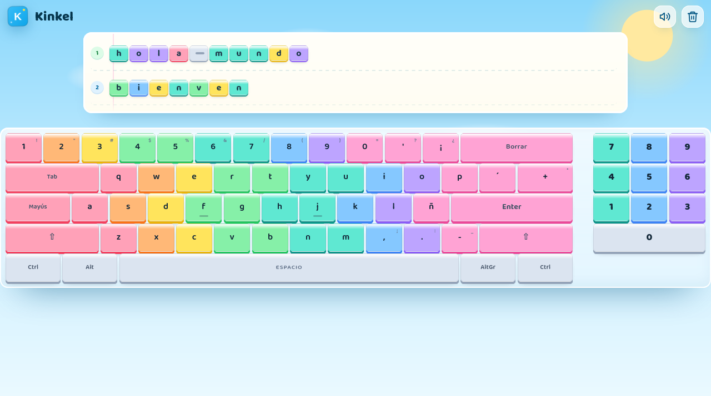

# Kinkel 🐧

App-juego de escritorio para que niños de **5 a 7 años** descubran el teclado
de una forma divertida. El teclado es el protagonista: al pulsar una tecla, la
**tecla completa** se ilumina, sale volando y aterriza en una pizarra donde
queda como una **mini tecla**. No es una app de práctica de escritura: lo
importante es ver, tocar y jugar con el teclado.

Contenido en **español (Latinoamérica)**, teclado **LATAM** con Ñ, acentos,
teclas muertas y su fila superior de números.



## Estado

| Fase | Contenido | Estado |
|------|-----------|--------|
| 0 | Setup del proyecto y limpieza del template | ✅ |
| 1 | MVP: teclado en pantalla, teclas voladoras, pizarra de teclas | ✅ |
| 2 | Config de modos (libre/lecciones), pingüino mascota, estrellas, confetti | Pendiente |
| 3 | Empaquetado desktop con Tauri + releases automáticos (Windows/macOS/Linux) | ✅ |

## Qué incluye

- Teclado **LATAM** en pantalla de **55 teclas**, con la distribución real
  (Ñ, ¡¿, `´` y `¨` como teclas muertas) y su **fila superior de números 1–0**.
- **Paleta viva por dedo** (mecanografía), teclas más grandes y radios más
  compactos, con marcas de posición guía en **F** y **J**.
- El teclado está **centrado y es el protagonista**, ocupa todo el ancho;
  la pizarra queda compacta arriba y en segundo plano.
- Al pulsar, la tecla se **hunde y brilla** con un halo de luz.
- La **tecla completa vuela** (fondo, padding, etiqueta y color de dedo) en
  arco desde el teclado hasta la pizarra.
- Al aterrizar, en la pizarra queda la **tecla completa como mini tecla**, no
  una letra suelta. Los acentos se conservan: `´` + `a` queda como una tecla
  con `á`.
- **Cualquier tecla deja su huella**: además de letras, números y signos, se
  dibujan **Ctrl, Alt, Shift, Bloq Mayús, Tab, Enter, teclas muertas, flechas,
  F1–F12 y teclas multimedia**. Las que no existen en el teclado LATAM de la
  app **aparecen desde los alrededores del teclado** con un fundido suave y
  siguen el mismo vuelo en arco hasta la pizarra.
- La barra espaciadora vuela como una tecla y en la pizarra se lee
  **“espacio”**, no una raya ni guiones.
- **Shift** y **Bloq Mayús** cambian mayúsculas; los símbolos con Shift se
  muestran en la tecla. **Enter** abre una línea nueva (y también vuela) y
  **Backspace** borra.
- **Números en la fila superior**: `1–0` escriben dígitos y sus símbolos con
  Shift, igual que en un teclado LATAM real.
- **Cada tecla es una nota de piano**: un sintetizador con armónicos, filtro y
  ruido de martillo (Web Audio API, sin assets). Las filas suenan en octavas
  distintas y cada tecla conserva su nota. Botón de silencio y borrado total
  con confirmación.
- La pizarra se guarda sola (localStorage) con el origen de cada tecla y se
  conserva al reabrir. Los datos de la versión anterior se migran.
- **Descarga desde la web**: junto a sonido y borrar aparece un botón que
  abre un modal mínimo con macOS, Windows y Linux; cada botón **Descargar**
  enlaza directo al instalador de la última versión. En la app de escritorio
  el botón se oculta.
- Respeta `prefers-reduced-motion` (sin vuelos, las teclas aparecen directo).

## Requisitos

- Node.js + pnpm
- [Rust](https://rustup.rs/) solo si quieres compilar la ventana desktop en
  tu equipo. Los releases oficiales se compilan en GitHub Actions.

## Desarrollo

```bash
pnpm install
pnpm dev        # abre la app en http://localhost:1420
pnpm build      # typecheck (tsc) + build de producción
```

### Desktop

```bash
pnpm tauri dev    # requiere Rust instalado
pnpm tauri build  # genera los paquetes de la app para tu sistema
```

Para instalar la app sin compilar, usa los instaladores del último release:
[github.com/xenoxf/Kinkel/releases/latest](https://github.com/xenoxf/Kinkel/releases/latest).

## Estructura

```
src/
  keyboard/layout.ts      # teclado LATAM: teclas, coordenadas, dedos y acentos
  game/board.ts           # celdas de la pizarra (carácter + tecla de origen)
  game/metrics.ts         # métricas de la pizarra (celda y alto de línea)
  audio/sounds.ts         # sonidos sintetizados con Web Audio API (sin assets)
  components/
    Keyboard.tsx          # teclado en pantalla sobre una grilla de 74 columnas
    Key.tsx               # tecla individual (color de dedo, estados)
    TextStage.tsx         # pizarra con mini teclas, cursor y numeración
    DownloadModal.tsx     # modal de descargas (macOS / Windows / Linux)
    Icons.tsx             # iconos SVG
  App.tsx                 # entrada de teclado, vuelos y estado del juego
src-tauri/                # shell desktop (Tauri 2)
.github/workflows/
  release.yml             # builds y release automático al empujar un tag v*
```

## Versionado y releases

- `main` es la rama principal; cada tarea terminada se commitea y pushea.
- La versión se mantiene sincronizada en `package.json`,
  `src-tauri/tauri.conf.json` y `src-tauri/Cargo.toml`.
- Para publicar, empuja un tag `vX.Y.Z`:

```bash
git tag -a v0.4.0 -m "Kinkel v0.4.0"
git push origin v0.4.0
```

El workflow [`.github/workflows/release.yml`](.github/workflows/release.yml)
compila en GitHub Actions y crea el release con los instaladores:

| Sistema | Artefactos |
|---------|------------|
| Windows | `.exe` (NSIS) y `.msi` |
| macOS | `.dmg` universal (Apple Silicon + Intel) |
| Linux | `.AppImage`, `.deb` y `.rpm` |

No hace falta compilar ni subir binarios desde el equipo local. El modal de
descarga de la versión web construye las URLs directas de esos instaladores.
